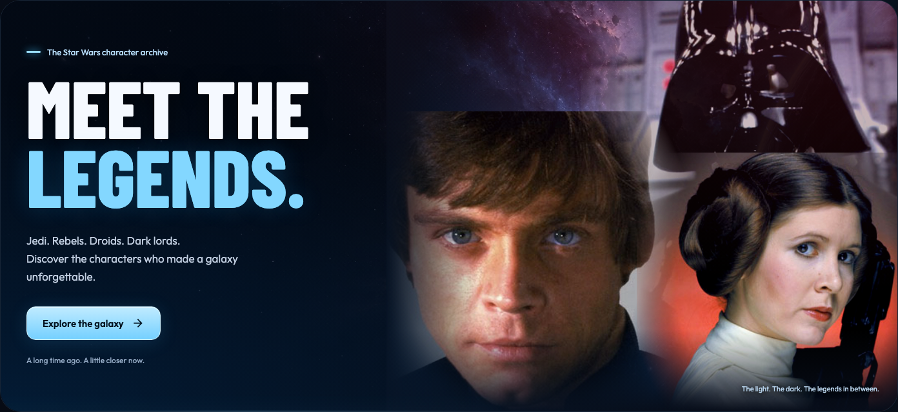
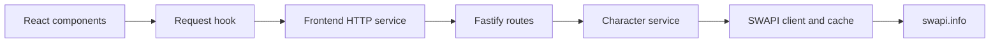
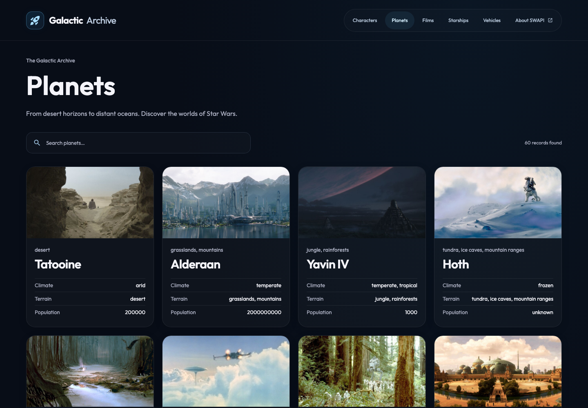
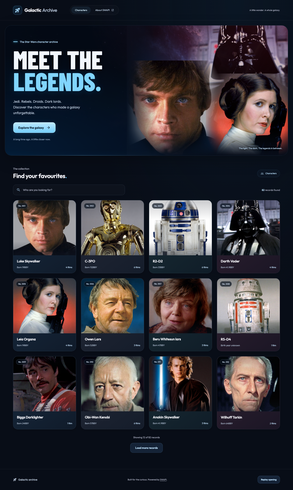
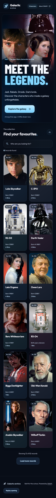
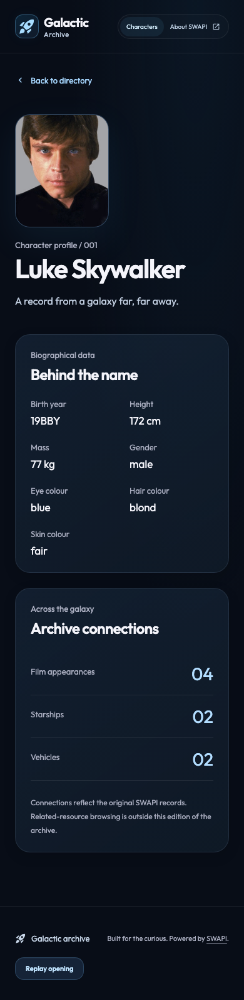

<div align="center">

# Galactic Archive

### Meet the legends. Explore the galaxy.

A cinematic Star Wars character explorer, built with React, TypeScript and Fastify.

[](https://github.com/HayleyBrinicombe/swapi-explorer/actions/workflows/ci.yml)


[Open the live app](https://swapi-explorer-chi.vercel.app) · [Watch the demo](https://raw.githubusercontent.com/HayleyBrinicombe/swapi-explorer/main/docs/demo.webm) · [Quick start](#quick-start) · [Architecture](#architecture) · [Engineering decisions](DECISIONS.md)

</div>



## Try it

**[Launch Galactic Archive](https://swapi-explorer-chi.vercel.app)** — open the interactive application directly. No installation, account or API key is required.

**See it in action:** [watch the recorded walkthrough](https://raw.githubusercontent.com/HayleyBrinicombe/swapi-explorer/main/docs/demo.webm), including the cinematic opening and interactive cards. [Browse the screenshots](#screenshots) for desktop, mobile and character detail views.

**Run it locally:** follow the quick start below to explore the code and run the application on your machine.

## Quick start

Requires **Node.js 24 LTS**, npm and Git. No API key, environment file, database or Docker is required.

```bash
git clone https://github.com/HayleyBrinicombe/swapi-explorer.git
cd swapi-explorer
npm install
npm run dev
```

Open **[http://127.0.0.1:5173](http://127.0.0.1:5173)**.

One command starts both Vite and the Fastify API, with automatic reloads as you edit. Stop both with **Ctrl+C**. Internet access is required for SWAPI data; character images and fonts are included locally.

<details>
<summary>Using nvm or troubleshooting startup?</summary>

The repository includes `.nvmrc`. If you use nvm, run these commands inside the cloned repository before installing dependencies:

```bash
nvm install
nvm use
```

- Check your version with `node --version`: this project targets Node **24.x**. nvm itself is optional; any Node 24 installation works.
- Keep ports **5173** (frontend) and **3001** (API) available. Vite proxies `/api` to `127.0.0.1:3001`.
- If a port is occupied, stop the existing process before restarting.
- Restart `npm run dev` after changing installed dependencies to refresh Vite's dependency cache.
- An upstream error offers **Try again**; check your connection if SWAPI cannot be reached.

</details>

## What you can explore

- **Explore beyond the character:** homepage image previews lead straight to homeworlds, films and craft in Luke’s profile; section shortcuts make other profiles easy to explore.
- **Browse the wider archive:** top navigation opens searchable planet, film, starship and vehicle collections, with local imagery and Load more.
- **Browse and discover:** portrait cards, instant name search, result counts and Load more.
- **Open a character profile:** shareable URLs, biographical details, homeworld facts, film appearances and named starships/vehicles with local imagery.
- **Feel the atmosphere:** an eight-second opening, dramatic typography and red/blue lighting. Skip with the button or Escape; replay from the footer. Fresh page loads replay the opening.
- **Interact with the collection:** card depth, portrait zoom and height/mass previews on hover or keyboard focus.
- **Use it across devices:** responsive layouts, labelled search, a skip link, visible focus, skeletons, helpful errors and reduced-motion support.

## Architecture



| Boundary                      | Responsibility                                                                 |
| ----------------------------- | ------------------------------------------------------------------------------ |
| Frontend components           | Present records, search locally and manage navigation/focus                    |
| Request hook and HTTP service | Request lifecycle, cancellation, retry and response validation                 |
| Routes                        | Validate HTTP input and return consistent responses                            |
| Character service             | Transform source records into our contract and select details                  |
| SWAPI client                  | Fetch and validate source data, enforce a timeout and cache successful results |
| Shared contracts              | Zod schemas and inferred TypeScript types used across the application          |

**Why a backend?** It gives the application an owned contract, upstream validation, caching and safe error translation. A frontend-only version could satisfy browsing; this split makes the full-stack boundaries explicit at the cost of an extra process and network hop.

**Why local search?** The verified SWAPI people endpoint returns a plain array of 82 records. The tested search/page parameters returned the same full collection. Fetching this small collection once and filtering names locally gives immediate results.

**Why no database?** The application reads public source data and has no user-owned records or writes to persist. The upstream client keeps a five-minute process-local cache per collection and shares concurrent requests; a five-second timeout bounds upstream waits. Failed requests are not cached.

### API

| Endpoint                  | Success response              |
| ------------------------- | ----------------------------- |
| `GET /api/characters`     | `{ characters: Character[] }` |
| `GET /api/characters/:id` | `{ character: Character }`    |
| `GET /api/characters/:id/connections` | `{ homeworld, films, starships, vehicles }` |
| `GET /api/archive/planets` (also `films`, `starships`, `vehicles`) | `{ records: RelatedRecord[] }` |

IDs come from validated source URLs, not array positions. API IDs must be positive integers of at most six digits. Errors use `{ error: { code, message } }`: **400** invalid input, **404** missing record, **502** upstream HTTP/network/schema failure, **504** upstream timeout and **500** unexpected failure. Diagnostics stay in server logs.

[DECISIONS.md](DECISIONS.md) records the alternatives, costs and production implications of these choices.

## Code organisation

```text
src/
  assets/                   Local fonts, organised images and source catalogue
  components/
    ui/                     Button, Card, Container, Stack, Typography,
                            Badge, Skeleton, ResourceState and CinematicIntro
    features/characters/    Character browse, hero, card, portrait and detail
    features/archive/       Category collection views and shared resource cards
  hooks/                    React request state, cancellation and retry
  services/                 HTTP fetching, validation and safe error messages
  styles/                   Design tokens, base styles and feature motion
server/
  app.ts                    Routes, request validation and error responses
  characters.ts             Character service and data transformation
  connections.ts            Resolve homeworld, films and craft relationships
  resources.ts              Shared resource transformations and collection service
  swapi.ts                  Source clients, validation, timeout and per-collection cache
  index.ts                  Startup and production static serving
shared/contracts.ts         Runtime schemas and TypeScript API contracts
e2e/                        Playwright journeys and deterministic fixtures
api/index.ts                Hosted HTTP entry point using the existing Fastify app
vercel.json                 Frontend build and same-origin API routing
.github/workflows/ci.yml     Automated checks on pushes and pull requests
```

The small design system uses typed native HTML props and composition. `Button` defaults to `type="button"`; `ButtonLink` retains navigation semantics; `Card` provides a surface; `Typography` separates heading level from appearance. Tokens centralise colour, spacing, typography, radii, shadows and motion. Components remain feature-specific where reuse would add little value.

Unit and component tests live beside their source. Browser tests live in `e2e/`. One root package keeps installation and scripts straightforward.

## Verification

```bash
npm test               # API, component and request-lifecycle tests
npm run typecheck      # Strict TypeScript checks, including browser tests
npm run build          # Type-check and build frontend + backend
```

Install Chromium once, then run the browser suite:

```bash
npx playwright install chromium
npm run test:e2e
```

Playwright starts the development server automatically or reuses an existing local server. The tests use deterministic API fixtures; they do not depend on live SWAPI availability. Browser failures retain screenshots and traces in `test-results/`.

**Locally verified:** 23 Vitest tests and 30 Playwright tests passed, along with type-checking and the production build. A fresh checkout was also installed with `npm ci`, built, and used to serve the frontend and a live character response successfully.

**Live deployment verified:** anonymous browser checks covered browsing, search, character details, refresh, mobile width and image loading. Live API checks confirmed successful responses, invalid input (400) and missing records (404).

Coverage includes mapping, malformed/missing IDs, upstream failures and timeouts, cache expiry/concurrent calls, request races/cancellation, loading/error/retry, search, load more, direct links/history, portrait fallbacks, hover/focus previews, opening duration/refresh/replay, keyboard navigation and four viewport widths. Automated WCAG A/AA scans cover browse and detail; they supplement manual review rather than establish full accessibility conformance.

GitHub Actions runs installation, tests, build and Chromium checks on pushes and pull requests, and uploads browser artifacts on failure. Its status badge above reports the hosted result. The workflow needs no secrets. Local checks are distinct from a hosted CI run.

## Preview the production build

Stop the development server first to free port 3001, then run from the repository root:

```bash
npm run build
npm start
```

Open **[http://127.0.0.1:3001](http://127.0.0.1:3001)**. Fastify serves the built frontend and API from one origin. `PORT` can change the production port; the current start script uses macOS/Linux environment-variable syntax.

## Public hosting

The complete application is hosted at **[swapi-explorer-chi.vercel.app](https://swapi-explorer-chi.vercel.app)** using the tracked Vercel configuration:

- Vite builds the frontend into `dist/client`, served as static assets.
- Requests under `/api` go to `api/index.ts`, which forwards them to the existing Fastify app. Routes, validation, transformations and upstream error handling stay in `server/`.
- Frontend and API share an origin, so no separate API URL or CORS setup is needed.
- Node.js 24 is selected from `package.json`. No API keys or runtime secrets are required.

To deploy in your own Vercel account, import this GitHub repository at [vercel.com/new](https://vercel.com/new). The tracked `vercel.json` supplies the build command, output directory and API routing. Keep the production URL publicly accessible so reviewers can open it without signing in. Only share the live URL after checking the page and `/api/characters` anonymously.

Vercel runs the backend as a Node.js function. Its in-memory cache belongs to each warm instance and can disappear on a cold start; it is an optimisation, not durable storage. Source data still comes from SWAPI at request time. The backend does not run on GitHub Pages.

The initial production deployment was published with the Vercel CLI. GitHub Actions runs the checks independently; automatic Vercel deployment on Git pushes requires connecting the repository in the Vercel account.

## Screenshots

<details>
<summary>Planets and category navigation</summary>



</details>

<details>
<summary>Desktop collection</summary>



</details>

<details>
<summary>Mobile collection and character profile</summary>




</details>

## Scope and trade-offs

I prioritised a complete character-exploration journey, a consistent component system and clear backend boundaries. The archive also provides lightweight category browsing; authentication and persistence remain outside its read-only scope.

Known limits: species browsing and separate resource detail pages are deferred; related-image coverage is partial; search is not reload-persistent; returning to the collection retains search but resets the revealed-card count. The cache is process-local, with no stale-on-error policy, offline mode or automatic retries. Chromium is covered; other engines, load tests and a broader assistive-technology audit remain future work.

Production requirements could justify server-side search/pagination, persistence for saved records, shared caching, a router/query library, responsive image formats and operational monitoring. The hosted configuration sets content-type and referrer security headers; rate limiting and a broader security policy remain future work.

## Credits and AI-assisted development

Data: [SWAPI](https://swapi.info/). Related-resource images: official Star Wars pages and credited specialist references, documented in the [image sources](src/assets/images/README.md) and [source catalogue](src/assets/images/resources.json). Portraits: [Star Wars Gallery](https://github.com/vieraboschkova/swapi-gallery), with an explicit [local source catalogue](src/assets/images/characters/README.md). SWAPI itself has no portrait fields. Star Wars imagery belongs to its respective rights holders; this fan project claims no ownership or open licence to that artwork.

Fonts: Google Fonts **Outfit** and **Barlow Condensed**, self-hosted with their licences. Icons: **Google Material Icons** through React Icons. The [decorative space artwork](src/assets/images/galaxy/README.md) was AI-generated; its prompt is recorded. The opening is CSS animation, with no runtime video download or audio.

I set the product direction, selected the stack, and directed the component architecture, visual design and testing priorities. AI assistance supported implementation, API investigation, test development, documentation and decorative artwork. Reported checks were run during development and are backed by the GitHub Actions workflow.
